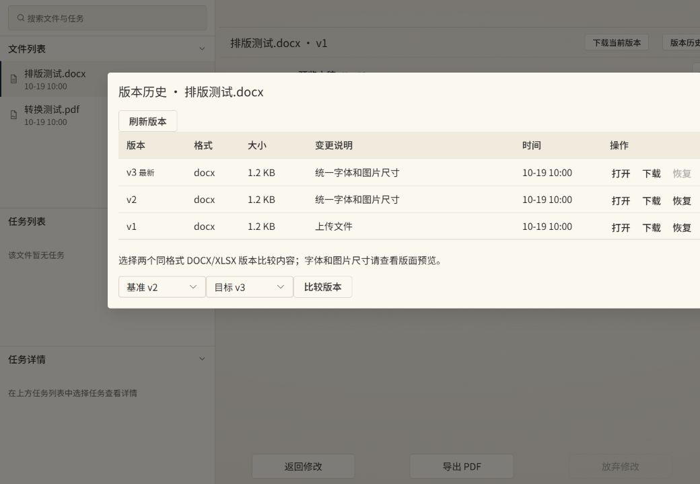
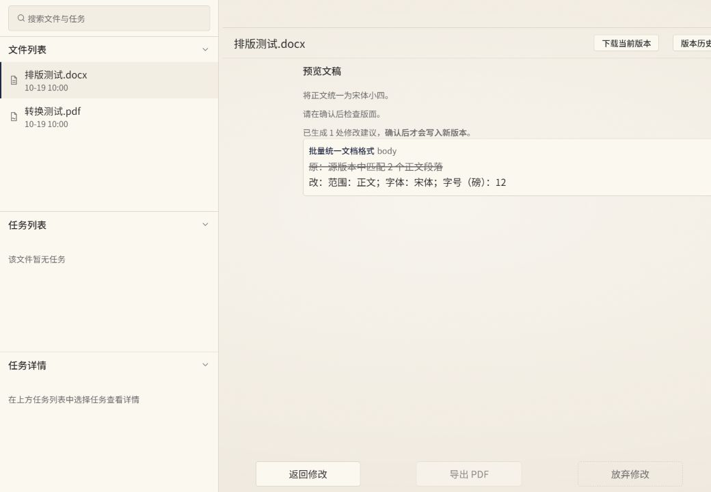

# 核心功能补齐（2026-10-19）

本次只使用现有后端接口，实现文件打开和版本历史、AI 会话历史与计划恢复、转换/导出任务入口。

## 文件与版本

- 点击侧边栏文件直接打开明确版本；URL 记录文件与版本，刷新后恢复。
- 工具栏可下载当前打开版本。下载名使用该历史版本的扩展名，避免 PDF 转 DOCX 后仍下载成 `.pdf`。
- “版本历史”展示所有版本、时间、格式、大小和变更说明，支持打开、下载、恢复；恢复会创建新版本，保留旧版本，并传入 `expectVersion`。遇到 409 请刷新历史后重新选择。
- 可选择两个同格式 DOCX/XLSX 版本比较内容。排版变化仍需查看页面预览。
- 查看历史版本后返回修改，新 AI 请求明确使用文件最新版本；页面会展示此说明。

## AI 会话与恢复

- 工具栏“AI 会话历史”支持搜索、状态筛选、当前文件筛选、分页、消息展示、归档和删除。
- 点击一条 AI 回复，从 `GET /ai/sessions/{sessionId}/replies/{messageId}` 读取真实回复及计划。待确认、已确认、已放弃、运行中和失败状态分别按后端状态处理。
- 当前会话/回复 ID 记录在 URL，刷新后自动读取，不在 localStorage 保存计划内容。恢复计划不会重新生成 AI 回复，也不会自动写文件。
- 归档会话只读，不可继续确认或放弃未处理计划；归档、删除前会说明影响并确认。删除当前会话后退出该上下文。
- 历史普通对话可阅读；旧版非回复消息如果没有对应回复资源，会显示后端返回的错误。

## 转换与导出

- “转换／导出”读取最新版本的真实格式。PDF 提供“优先可编辑”和“优先保持版式”两种 PDF → DOCX 模式。
- 可导出格式与后端 `DocumentExportService` 一致：PDF、DOCX、XLSX、PPTX、ODT、ODS、ODP、DOC、XLS、PPT；图片不提供不受支持的转换选项。
- 提交 `CONVERT` / `EXPORT` 时绑定明确 `inputVersion`；不使用 AI_EDIT/OCR 异步任务类型。因结果会写入新版本，只允许基于最新版本执行；历史内容需要先恢复。
- 网络超时重试沿用同一请求和幂等键，防止后台已创建任务后又重复创建。
- 创建后自动选中真实任务，复用取消/重试和轮询。成功后“打开结果 vN”进入输出版本，随后可从工具栏下载。
- 同步“导出 PDF”仅下载，异步“导出为 PDF 新版本”会写版本历史，两个入口含义不同。

## 验证与边界

- 已保留作者在 `77fa176` 之前补齐的 API 封装；当前契约扫描为 130 处调用封装、124 个不同接口，方法/路径全部匹配后端。API 封装齐全不代表所有页面齐全。
- `npm run type-check`、`npm test`（27 项）和 `npm run build` 均通过。
- 浏览器使用本地模拟后端验证文件打开、历史版本打开、恢复新版本、任意版本比较、历史回复恢复、刷新恢复、转换任务创建/完成/打开结果和下载按钮。
- 可在本地运行 `node scripts/local-ui-fixture.mjs` 重现页面测试，入口为 `http://127.0.0.1:5174/docu_frontend/`。只监听本机，使用虚构测试数据及本地模拟登录，不使用正式环境账号；关闭进程后数据不保留。
- 正式环境的模型效果、真实文件转换和字体排版仍需部署后联调。构建保留既有大 chunk 提示。
- OCR、模板生成、人工高级编辑、管理员高级配置及 SSE 流式输出不在这次范围内。

本地模拟页面截图：

